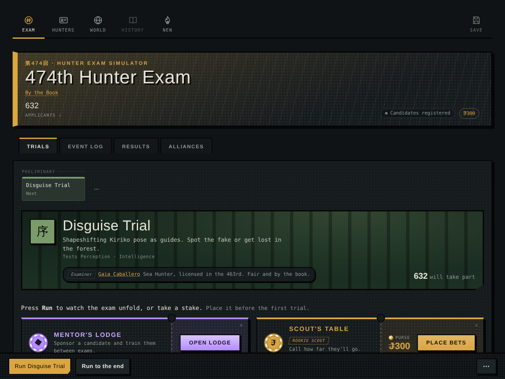
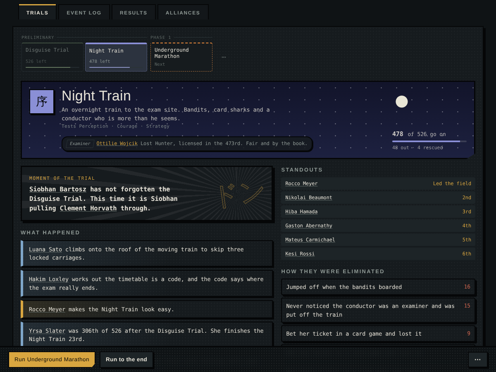
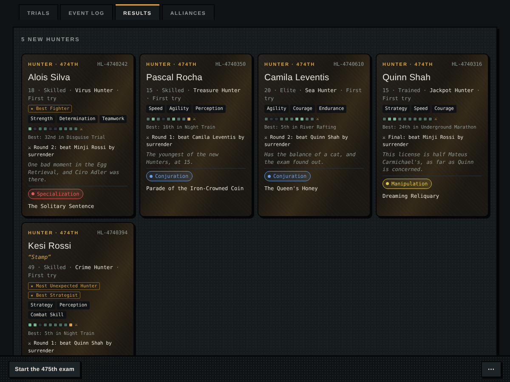
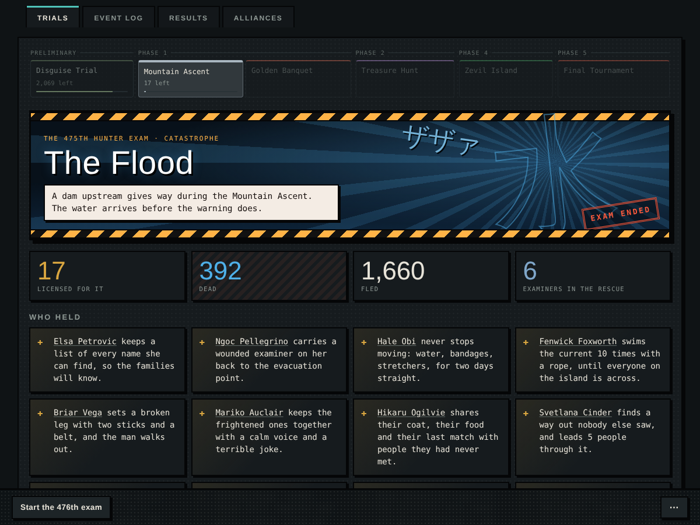

# Hunter Exam Simulator

A Hunter × Hunter–inspired simulator of the Hunter Exam, and of the world around it, that runs entirely in the browser. Every year thousands of applicants try for a license: they form alliances, betray each other, get nicknames, fall in trials and come back the next year. Between exams the world moves on. Hunters take contracts, marry, have children, run for Chairman, go to the Dark Continent and sometimes don't come back.

No build step, no server, no dependencies. Open `index.html` and it runs.

| | |
|---|---|
|  |  |
|  |  |

## What's in it

**The exam**
- Every edition draws its own route: preliminary trials, endurance trials, a second phase, a team trial with duels, Zevil Island and the Final Tournament.
- Examiners are real Hunters from the register. Each has a style that changes who gets through.
- Each exam has a cast: the candidates the story keeps returning to. Scenes remember their injuries, debts, grudges and names; the camp cuts back to them; small finds, wanderings and jokes fill the gaps.
- A theme for each year (storms, the Crimson Ledger, the Chairman's dice…). Some themes bring a trial of their own.
- Jubilee and Centennial exams. And, about once in fifty years, a catastrophe that ends the exam.

**The people**
- Each applicant has a background, a motive, a temperament, quirks, fears and talents. Some also have secrets, rivals, unbreakable bonds and nicknames.
- Families take the exam together. Children of Hunters, and of legendary Hunters, come of age and enter.

**Playing**
- **Mentor's Lodge:** sponsor an apprentice, train them between exams, make their calls in each trial and live their Zevil days and Final bouts.
- **Scout's Table:** bet on how far candidates will go.
- **Nen:** a type test and a Hatsu forge.

**The world**
- Careers with contracts by rank, star promotions and Blacklist hunts.
- Dark Continent expeditions, crises, and places with a history.
- Elections for Chairman and the Zodiac.
- Cases before the council: accusations, investigations, trials, verdicts, and old cases reopened decades later.
- Schools of Nen: masters take students, found schools, pass them on, and sometimes split them in two. Their dojos send candidates to the exam; a few already know some Nen. Each school has a crest that tells its story; branches carry their parent's arms with a mark of difference.
- The missing who come back find their seat taken, their spouse remarried, or a case still waiting for them.
- Thirty-four relics, each with a gift and a price: found on the Dark Continent or in old ruins, inherited, stolen, sealed, forged.
- Advance +1, +10 or +50 years without watching each exam; the run stops when something you care about happens.
- Statistics: population, causes of death, pass rates, Nen, dynasties, schools, cases, outlaws, relics.
- A newspaper for every exam, plus family trees across generations.

Saves live in the browser (IndexedDB, with a localStorage fallback). The save menu exports and imports a file.

## Running it

- **Locally:** open `index.html` in a browser.
- **GitHub Pages:** push the repository, then go to *Settings → Pages* and deploy from the `main` branch (root). Nothing to build.
  - Then put the real address in the search and sharing tags: `node tools/set-site-url.js https://somewell00-sketch.github.io/HunterExamSim/`. This updates the canonical link, the Open Graph and Twitter cards, `robots.txt` and `sitemap.xml`.
  - To show up on Google sooner, add the site in [Google Search Console](https://search.google.com/search-console) and submit `sitemap.xml`.
- **Single file:** `npm run build:single` writes `dist/hunter-exam.html`, with everything inlined into one file.

## Project layout

```
index.html              page markup; loads the files below in order
css/
  base.css              layout and components
  manga.css             the ink-and-screentone skin
js/engine/              the simulation (no DOM)
  01-core.js            attributes, applicants, trials and the yearly route
  02-drama.js           set pieces, injuries, debts, promises, rookie crushers
  03-themes-secrets-final.js
  04-backgrounds.js     life stories
  05-catastrophe.js     the exam that never finishes; the trial runner
  06-narrative.js       personas, nicknames, themed trials
  07-alliances.js
  08-nen-and-run.js     Nen, and running a phase
  09-cast.js            the cast of each exam, scenes that remember, finds, jokes and cutaways
js/ui/                  everything on screen
  01-state.js           state and saving
  02-nen-lab.js
  03-scout.js
  04-mentor.js, 05-mentor-story.js, 06-mentor-live.js
  07-controls.js
  08-careers-world.js   Hunters' careers and the years between exams
  09-politics.js        Chairman, Vice-Chairman, Zodiac
  09b-chronicles.js     cases and trials, schools of Nen, coming back from missing
  09c-relics.js         the 34 relics: gifts, prices, owners, thefts, forgeries, the Atlas
  09d-crests.js         school crests (shape, field, colours and charge from the school's story) and relic icons
  10-herald.js          the newspaper
  11-exam-views.js      trial pages, Zevil Island, the Final
  12-association.js     the Hunter register
  12b-stats.js          yearly statistics and the Statistics section in History
  13-modals-nen.js      profiles and the Nen panel
  13b-advance.js        advancing years without watching each exam
  14-global.js          global clicks and start-up
tests/                  headless checks (Playwright)
tools/build-single.js   inlines everything into one HTML file
tools/set-site-url.js   writes the published address into the SEO and sharing tags
assets/                 icons and the social preview image
manifest.webmanifest    lets phones install it like an app
robots.txt, sitemap.xml for search engines
```

The scripts are plain (non-module) scripts and share one global scope, so **load order matters**. Keep the order in `index.html`. The engine files come first.

## Tests

```
npm install
npx playwright install chromium
npm test           # smoke run, themed trials, catastrophe, family trees, chronicles
npm run stats      # 100 simulated years: deaths, stars, nicknames
```

- `smoke`: plays 25 exams and draws every screen. Any page error fails it.
- `family`: simulates 200 years and checks that every family tie appears on both relatives' profiles.
- `themed-trials`: runs each theme's own trial to the end.
- `catastrophe`: forces one and checks the aftermath.
- `chronicles`: simulates 300 years and checks that cases reach verdicts, schools pass from master to student, relics change hands and the statistics are kept. `YEARS=100` makes it shorter.

The tests fix `Math.random` inside the page with a seed, so every run simulates the same world. `SEED=2 npm test` tries another world; `SEED=0` keeps it random. The game itself is never seeded. `CHROMIUM=/path/to/chrome` uses a Chromium you already have.

## Credits

A fan project inspired by *Hunter × Hunter* by Yoshihiro Togashi. Not affiliated with or endorsed by the author or publishers. All characters, places and events in the simulation are generated.
